# StreetBite V1.0

StreetBite is a production-oriented Flutter food discovery and ordering app.
Users authenticate with Firebase, discover live meals from TheMealDB, cache the menu locally, open meal details, save favourites, build a cart, place orders, switch English/Arabic, and choose light/dark themes.

## Features

- Fade-in splash screen with Firebase authentication persistence.
- Email/password login and registration with friendly Firebase error mapping.
- Full English and Arabic runtime localization using Flutter Localizations and ARB resources.
- Responsive home screen using `MediaQuery`, featured `PageView`, hot offers, and a two-column live menu.
- Dio + Retrofit TheMealDB integration with SharedPreferences cache fallback.
- Meal details with category, origin, instructions, favourite, and cart actions.
- Firestore-backed favourites, orders, and singleton data service.
- Biometric profile gate, Firestore profile photo upload, and live favourites and order history streams.
- Reactive cart count, quantity updates, removal, payment selection, and order placement. Cash and card strategies implement a shared payment contract.
- Light/dark theme switching using persisted `ThemeCubit` state.
- Nearby vendor map bonus screen with five hardcoded Egyptian locations (Cairo, Alexandria, Giza, Luxor, and Aswan); each marker shows the vendor name, cuisine type, and rating in its info window.

## Screenshots

### Onboarding and authentication

| Splash | Login | Sign up |
|---|---|---|
| 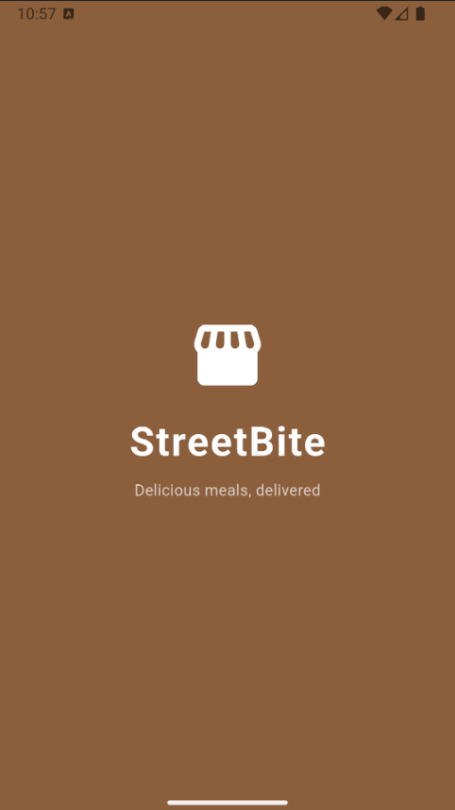 | 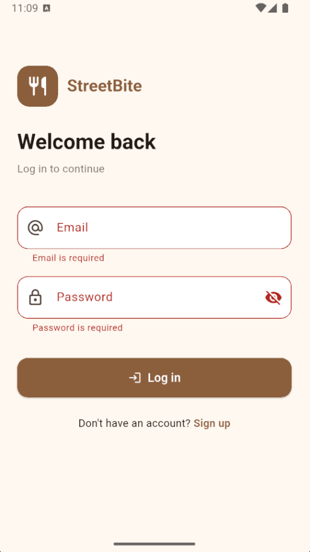 | 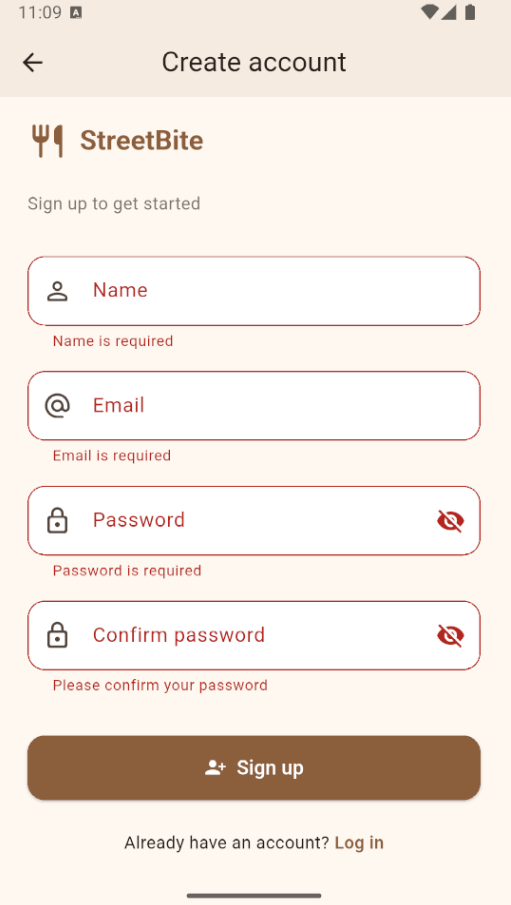 |

### Discovery and ordering

| Home - English | Home - Arabic | Meal details |
|---|---|---|
| 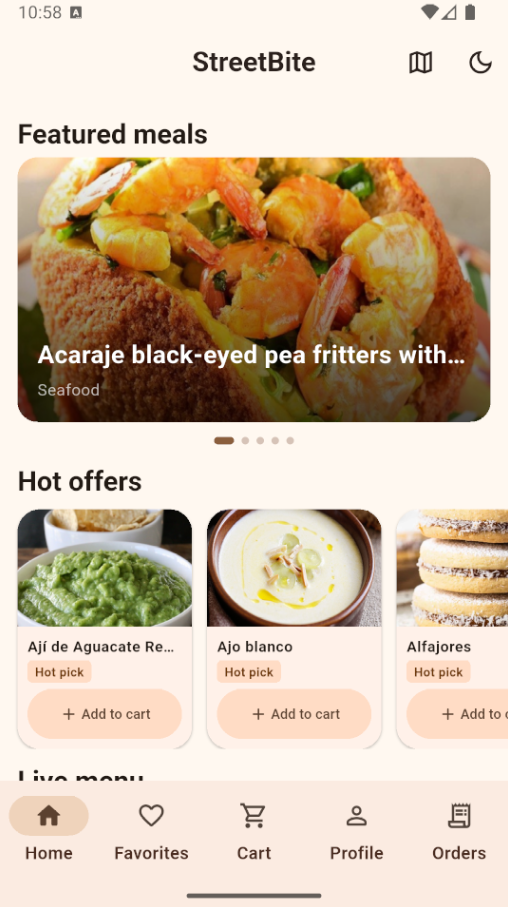 | 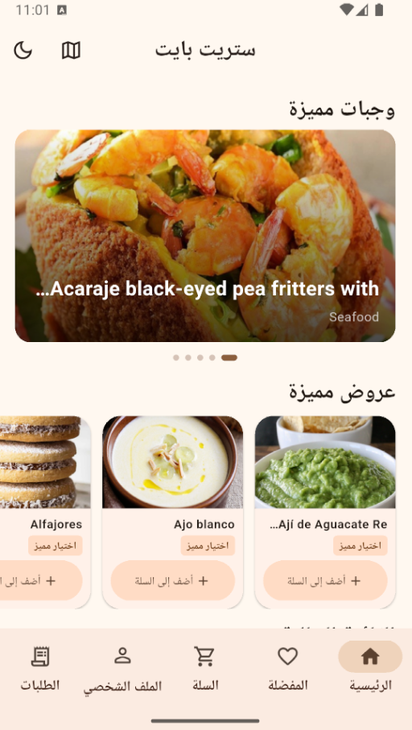 |  |

| Cart | Vendor map | Dark mode |
|---|---|---|
| 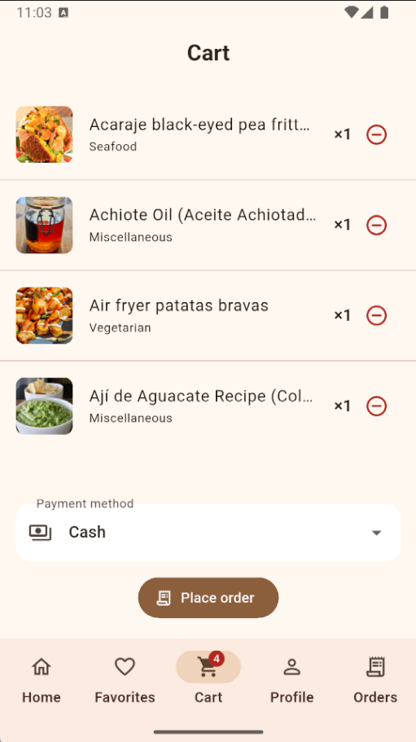 | 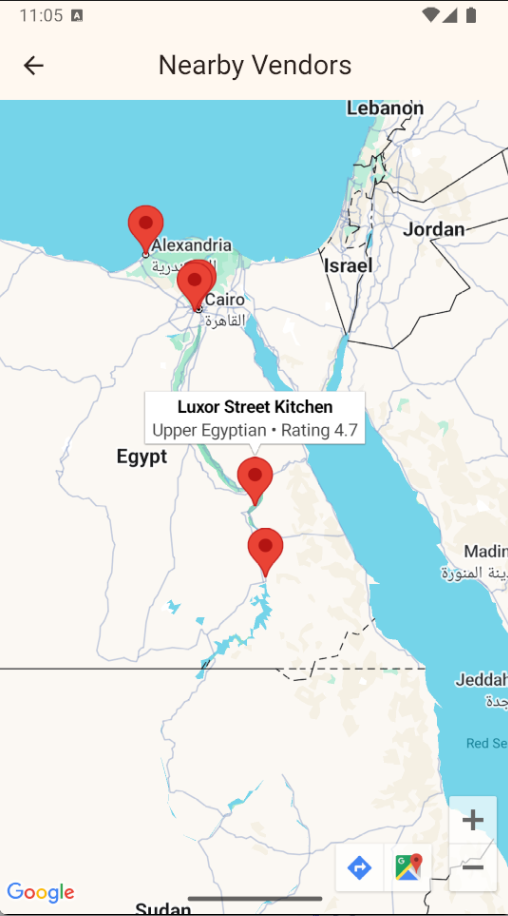 | 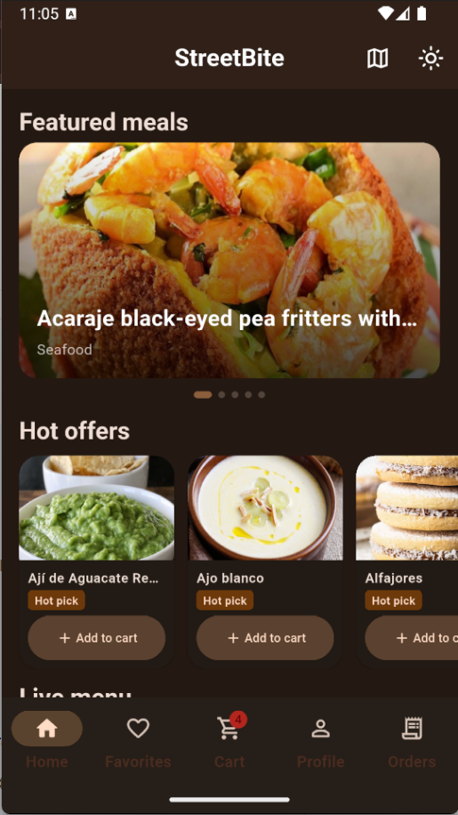 |

### Profile and security

| Profile | Biometric authentication |
|---|---|
| 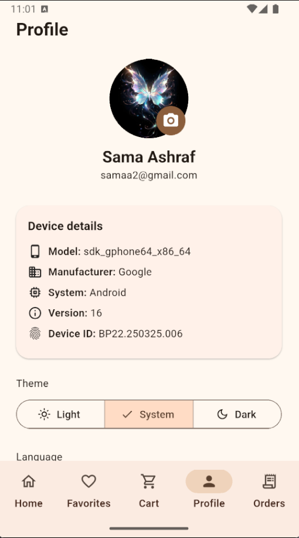 | 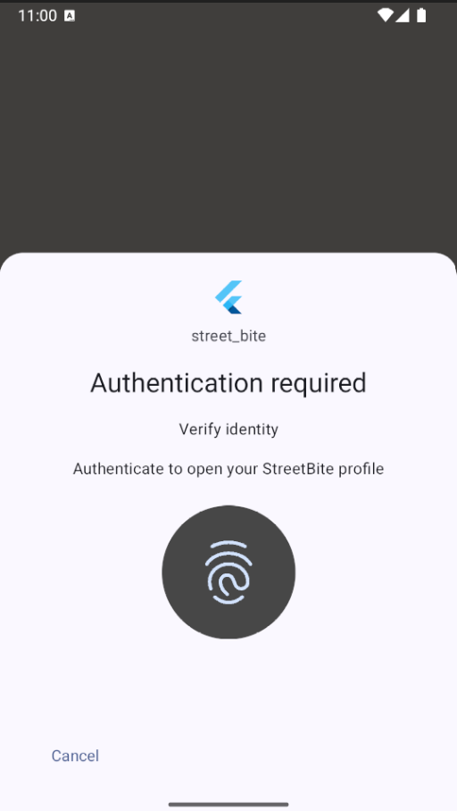 |

## Architecture

The project follows Clean Architecture:

```text
lib/
├── core/          # API, DI, preferences, theme, shared utilities
├── data/          # Retrofit sources, cache, Firestore service, models
├── domain/        # Entities, repository contracts, use cases
├── presentation/ # Cubits, screens, and reusable widgets
└── l10n/          # app_en.arb, app_ar.arb, generated localizations
```

Patterns used:

- **Builder:** `UserEntityBuilder` keeps authenticated profile construction explicit and extensible.
- **Factory:** `MealRepositoryFactory` selects a remote or cached repository implementation based on normal loading versus explicit refresh.
- **Singleton:** `FirestoreService.instance` provides one user-data gateway.
- **Strategy:** `CashPayment` and `CardPayment` implement `PaymentMethod`, so checkout can switch payment behavior without changing cart/order code.
- **Cubit:** `AuthCubit`, `MealsCubit`, and `CartCubit` isolate state transitions from widgets, making loading, success, and failure states testable.
- **Dependency injection:** GetIt wires interfaces, data sources, repositories, use cases, and Cubits in one composition root.

The data boundary catches Dio/network failures and falls back to cached meals
when possible. Authentication, profile, favourites, orders, and checkout catch
Firebase failures at their UI/state boundary and show localized friendly
messages instead of exposing raw exceptions. Unexpected failures are still
handled as a generic localized error; they are never converted into a
false-success state.

## Setup

1. Install Flutter SDK compatible with Dart `^3.10.4`.
2. Configure Firebase for the Android/iOS/web targets and place the generated Firebase options in the project.
3. Enable Email/Password Authentication and Cloud Firestore.
4. Add a Google Maps API key for Android/iOS if the bonus map screen is used.
5. Run:

```bash
flutter pub get
dart format lib test
flutter analyze
flutter test
flutter run
```

## Localization

Edit [lib/l10n/app_en.arb](lib/l10n/app_en.arb) and
[lib/l10n/app_ar.arb](lib/l10n/app_ar.arb). Flutter generates
`AppLocalizations` during `flutter pub get`; do not add hard-coded user-facing
strings to widgets.

## Firebase App Distribution

StreetBite uses Firebase App Distribution to deliver release APKs to beta
testers. The release workflow is:

1. Build a release APK:

   ```bash
   flutter build apk --release
   ```

2. Upload the APK from `build/app/outputs/flutter-apk/app-release.apk` using
   the Firebase console, or with the Firebase CLI:

   ```bash
   firebase appdistribution:distribute build/app/outputs/flutter-apk/app-release.apk \
     --app YOUR_FIREBASE_ANDROID_APP_ID \
     --release-notes "StreetBite V1.0 beta release" \
     --testers tester-one@example.com,tester-two@example.com
   ```

3. Confirm that the release appears in the App Distribution dashboard.
4. Invite at least two tester email addresses and verify that each tester receives the release invitation.
5. Testers install the APK from the invitation and report feedback for the beta build.

The dashboard evidence is included below:

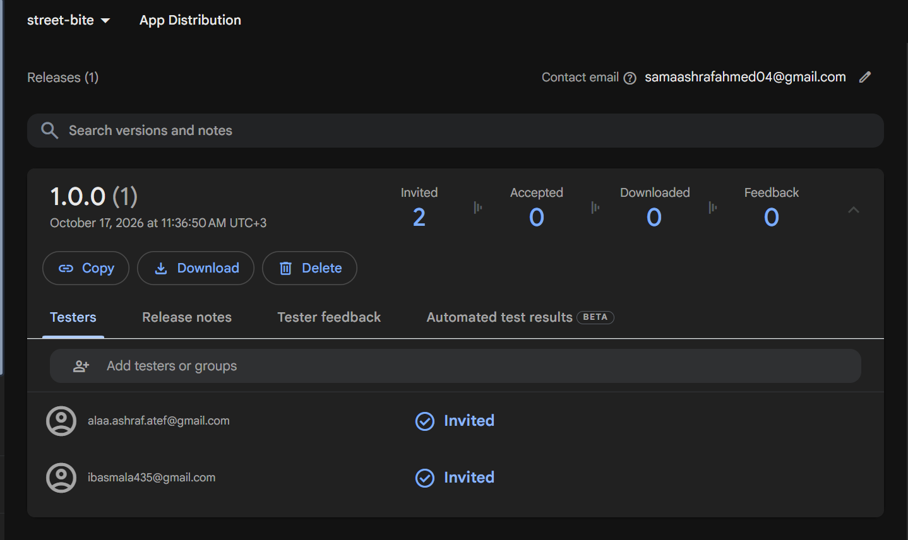

Replace `YOUR_FIREBASE_ANDROID_APP_ID` and the tester addresses with the
project-specific Firebase values before running the command. Firebase
credentials and API keys must not be committed to the repository.

## Permissions and services

- Android Internet permission is declared for API and Firebase access.
- Firebase Authentication persists the signed-in user across restarts.
- Firestore rules must restrict `users/{uid}` data to the authenticated owner.
- Google Maps requires platform API keys.
- Image selection and device details viewed in profile.
- Biometric Authentication to access profile.
